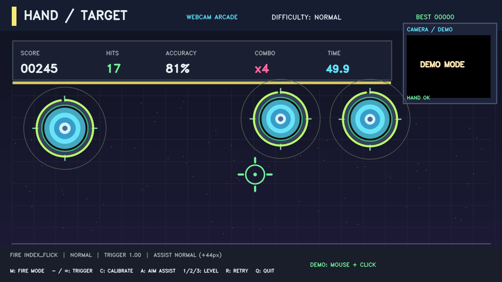
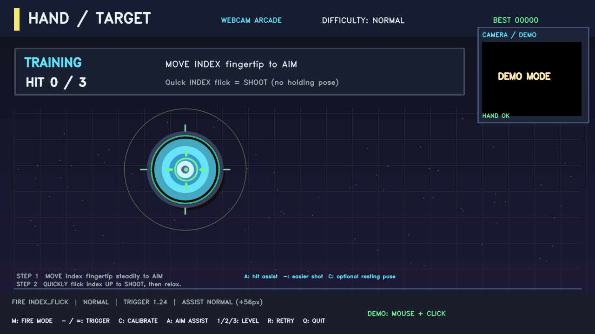

# RiG++ Hand Target Shooter v1.3 🎯

Webカメラで手を認識し、**人差し指で照準を動かし、素早い指の動きで的を撃つ** Windows向けゲームです。Python / OpenCV / MediaPipe Hand Landmarkerで動作します。



## v1.3で変わったこと

**「持続的な動き = 照準移動」「瞬間的な動き = 発射」**を別々に判定します。

| 操作 | 認識と動作 |
|---|---|
| 人差し指をゆっくり・連続的に動かす | **指先に照準が追従**。曲げたまま・伸ばしたままでも移動可能 |
| 人差し指を一瞬で「パッ」と伸ばす | **1発発射**（デフォルト：`INDEX_FLICK`） |
| 手全体を素早く左右に動かす | **照準移動**。指の付け根から見た相対的な動きがなければ発射しません |
| 指を伸ばしたままにする | **移動を継続**。押しっぱなしの自動連射はしません |

前の版では人差し指の付け根で照準を動かし、伸ばした状態で照準が固定されていました。この版では**指先の位置そのもの**で照準を動かします。発射判定は指先と人差し指の関節の**相対的な伸びる速さ**から計算するため、手全体の平行移動とは区別されます。

発射した瞬間だけ約0.085秒、照準を固定してブレを抑えます。その後は指を伸ばしたままでも移動できます。

## 遊び方

1. Webカメラに片手を映します。手と人差し指の関節が見える向きにしてください。
2. **人差し指の先を動かす**と照準が動きます。ゆっくり動かすだけでは発射しません。
3. 的に狙いを合わせ、**人差し指を軽く曲げた位置から、素早くパッと伸ばす**と1発撃てます。大きく曲げる必要はありません。
4. 次に撃つときはいったん指を少し戻し、再度素早く伸ばします。
5. 最初は**時間制限なしの練習**。3回的に命中すると本番を開始できます。

**練習モードの画像**



狙いが多少ずれても命中しやすいよう、的の外側に命中補正エリアがあります。練習中はさらに範囲が広くなります。

## 反応の調整

- **撃てないとき：** `-` または `[` を押すと、必要な動きの速さ・大きさが少し下がります。何度か押して試してください。
- **勝手に撃ってしまうとき：** `=` または `]` で発射判定を厳しくします。
- **指先で狙っても命中しないとき：** `A` キーで命中補正を `HIGH` に切り替えます。
- **自分の指の可動域に合わせたいとき：** 人差し指をリラックスさせた状態で `C` を押すと、伸ばす動きの最低幅をわずかに緩和できます。必須ではありません。
- **従来の方式に切り替えるとき：** `M` キーで `INDEX_FLICK → THUMB → PINCH` を順に切り替えられます。

**重要：** カメラによって手の形の推定に差が出ます。`-` で緩めるほど意図しない発射が増える場合もあるため、練習画面で調整してください。画面右下に `FLICK .../s` と表示され、指の伸びる速さを確認できます。

## Windowsで起動

1. ZIPを**「すべて展開」**します。
2. `RiG_HandTarget_Shooter_v1.3` フォルダを開きます。
3. `START_GAME_Windows.bat` をダブルクリックします。
4. 必要に応じてカメラへのアクセスを許可し、練習モードから始めてください。

初回起動時にPythonライブラリとMediaPipe公式モデルを取得します。ネット接続が必要です。64-bit Python 3.9〜3.14を探すように構成されています。Python 3.13 + Anaconda のWindows環境も対象です。

**カメラ番号1を使う場合：** `START_CAMERA1_Windows.bat`。

**カメラなしで遊ぶ場合：** `START_DEMO_Windows.bat`。このモードはマウス移動が照準、左クリックが発射です。手のジェスチャー判定そのものはテストできません。

### 手動実行

```powershell
python -m venv .venv
.\.venv\Scripts\python.exe -m pip install -r requirements.txt
.\.venv\Scripts\python.exe download_model.py
.\.venv\Scripts\python.exe main.py --camera 0
```

## キー一覧

| キー | 操作 |
|---|---|
| 人差し指を動かす | 指先の移動に合わせて照準を動かす |
| 人差し指を**素早く伸ばす** | 1発撃つ |
| `-` / `[` | 発射を緩くする |
| `=` / `]` | 発射を厳しくする |
| `A` | 命中補正切替（NORMAL → HIGH → OFF → LOW） |
| `M` | 発射ジェスチャー切替 |
| `C` | 任意の指の休止姿勢キャリブレーション |
| `1` / `2` / `3` | EASY / NORMAL / HARD |
| `Space` | 練習クリア後に本番開始 |
| `R` | 最初から練習をやり直す |
| `Q` / `Esc` | 終了 |

## ゲームルール

- 練習で的に3回命中すると「YOU ARE READY」になります。
- EASYは60秒、NORMALは50秒、HARDは40秒。
- 本番では動く的を撃ち、命中率・コンボ・得点を競います。
- ベストスコアはローカルの `data/highscores.json` に保存します。
- 手を見失うと本番のタイマーを一時停止します。

## 発射判定の技術的な仕組み

1. MediaPipeで21個の手のランドマーク（関節座標）を取得。
2. **照準用：** 人差し指の先（ランドマーク8）を滑らかに追従。
3. **射撃用：** 人差し指の付け根（5）から第2関節（6）に向かう方向に沿って、指先（8）がどれだけ伸びたかを手のひら幅で正規化。
4. 直近約160msの変化量と瞬間的な伸びる速さの**両方**がしきい値を超えたときだけ射撃。手を平行移動させただけでは発射しにくい。
5. 発射後は約260msのクールダウン＋指を少し戻す操作で誤連射を防止。**照準の移動は射撃状態から独立**しているため、指を伸ばしたままでも継続できる。

これは画像AIで指先を追跡するアーケード操作です。実機のカメラでの命中率は照明・カメラ角度・認識精度によって変わります。

## 構成

```text
RiG_HandTarget_Shooter_v1.3/
├── main.py                   # ゲーム起動、入力・画面管理
├── gesture.py                # 照準の追従と瞬間的な指の動作の判定
├── game_logic.py             # 的・練習・得点・命中補正
├── renderer.py               # ゲーム画面描画
├── camera_tracker.py         # WebカメラとMediaPipe
├── download_model.py         # モデル取得
├── requirements.txt
├── START_GAME_Windows.bat
├── START_CAMERA1_Windows.bat
├── START_DEMO_Windows.bat
├── RUN_TESTS_Windows.bat
├── README.md
├── CHANGELOG.md
├── examples/
└── tests/
```

## プライバシー、動作確認、ライセンス

- カメラ画像はゲームから外部へ送信せず、PC内で処理します。初回のライブラリとモデルのインストールでは通信します。
- 自動テストはロジック・描画・人工的な手の動きを検査します。実際のWebカメラでの反応速度・誤認識は未検証です。
- 本体：MIT License。外部ライブラリとMediaPipeモデルには各提供元の条件が適用されます。

テスト実行：`RUN_TESTS_Windows.bat`

## ライブラリ

- [MediaPipe Hand Landmarker](https://ai.google.dev/edge/mediapipe/solutions/vision/hand_landmarker/python)
- [OpenCV](https://opencv.org/)
- [NumPy](https://numpy.org/)
