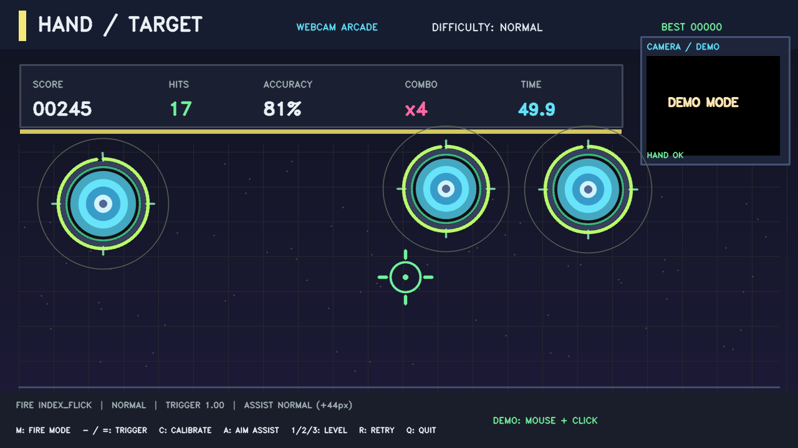

[English](README.md) | **日本語**

# Hand Target Shooter

Windows向けのWebカメラゲームです。人差し指の先で狙い、指をまっすぐ素早く伸ばすと「発射」します。Python、OpenCV、MediaPipe Hand Landmarkerで作りました。



## 課題

単純なハンドトラッキングでは、「狙う」動きと「撃つ」動きを区別しにくくなります。手全体を動かしただけで発射されてはいけません。

## 解決方法

持続的な動きと瞬間的な動きを分けて判定しています。

- **照準:** なめらかに補正した人差し指の先（ランドマーク8）に照準が追従します。
- **発射:** 指そのものの軸（ランドマーク5 → 6 → 8）に沿って指先が伸びる速さを、手のひらの幅で正規化して使います。約160 msの間の変化量と瞬間の速さの両方がしきい値を超えたときだけ発射するので、手全体を平行に動かしても反応しません。
- 約260 msのクールダウンと「指を戻す」動作を条件にして、意図しない連射を防いでいます。照準は発射状態に関係なく動きます。

## 主な機能

- 本番（EASY 60秒 / NORMAL 50秒 / HARD 40秒）の前に練習モード（的を3つ当てる）
- 動く的、コンボと命中率によるスコア、ローカルのハイスコア
- キー操作で感度とエイムアシストを調整。別の発射ジェスチャー（親指・ピンチ）も選べる
- カメラのないPC向けに、マウスで遊べるデモモード
- ゲームロジック、ジェスチャー判定、描画のユニットテスト（実カメラでの精度は未検証）

## 技術スタック

Python · OpenCV · MediaPipe Hand Landmarker · NumPy · pytest

## セットアップ（Windows）

`HandTarget_Shooter/START_GAME_Windows.bat` をダブルクリックするか、次を実行します。

```powershell
cd HandTarget_Shooter
python -m venv .venv
.\.venv\Scripts\python.exe -m pip install -r requirements.txt
.\.venv\Scripts\python.exe download_model.py
.\.venv\Scripts\python.exe main.py --camera 0
```

カメラの映像はPC内だけで処理します。ソースコードはMITライセンスです。MediaPipeなどのライブラリはそれぞれのライセンスに従います。遊び方・操作・発射判定の詳しい説明は [HandTarget_Shooter/README.md](HandTarget_Shooter/README.md)（日本語）にあります。
