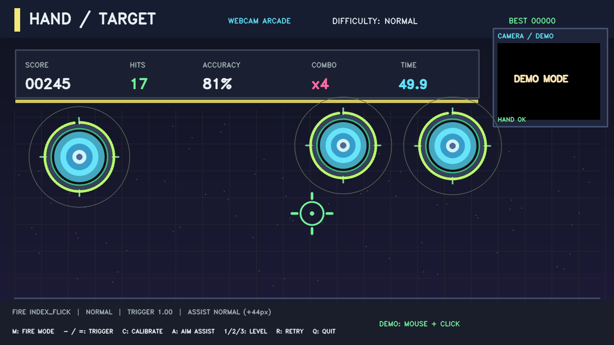

[English](README.md) | [日本語](README.ja.md)

# Hand Target Shooter

A Windows webcam game: aim with your index fingertip and "shoot" by snapping the finger straight. Built with Python, OpenCV and MediaPipe Hand Landmarker.



## Problem

Plain hand tracking makes it hard to tell *aiming* from *firing*: moving the whole hand should not shoot.

## Solution

Sustained motion and sudden motion are classified separately:

- **Aim:** the aiming reticle follows the smoothed index fingertip (landmark 8).
- **Fire:** the extension speed of the fingertip along the finger's own axis (landmarks 5 → 6 → 8), normalised by palm width. A shot fires only when both the change over ~160 ms and the instantaneous speed exceed thresholds, so translating the whole hand does not trigger it.
- Cooldown (~260 ms) and a retract requirement prevent accidental auto-fire; aiming stays independent of the firing state.

## Features

- Practice mode (hit 3 targets) before the timed round (EASY 60 s / NORMAL 50 s / HARD 40 s)
- Moving targets, combo and accuracy scoring, local high scores
- Adjustable sensitivity and aim assist via keys; alternate fire gestures (thumb / pinch)
- Mouse-driven demo mode for machines without a camera
- Unit tests for game logic, gesture detection and rendering (real-camera accuracy is untested)

## Tech stack

Python · OpenCV · MediaPipe Hand Landmarker · NumPy · pytest

## Setup (Windows)

Double-click `HandTarget_Shooter/START_GAME_Windows.bat`, or:

```powershell
cd HandTarget_Shooter
python -m venv .venv
.\.venv\Scripts\python.exe -m pip install -r requirements.txt
.\.venv\Scripts\python.exe download_model.py
.\.venv\Scripts\python.exe main.py --camera 0
```

Camera frames are processed locally. Source is MIT-licensed; MediaPipe and other libraries keep their own terms. Japanese documentation: [README.ja.md](README.ja.md).
